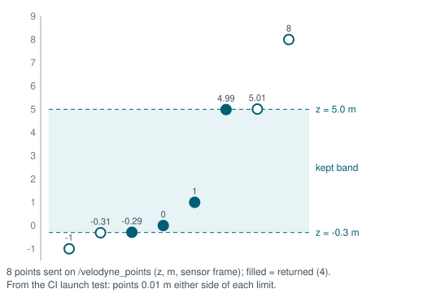

# Go2 Perception Pipeline

A custom ROS2 C++ perception pipeline for the Unitree Go2 quadruped robot in Gazebo simulation.
Subscribes to raw Velodyne LiDAR point clouds, removes ground plane using PCL PassThrough filter,
and publishes filtered obstacle points for downstream perception tasks.

## What This Does

- Raw LiDAR `/velodyne_points` → ground filter node → `/velodyne_filtered` (obstacles only)
- Custom Gazebo world with walls, boxes, and obstacles
- Pre-configured RViz layout showing raw (white) vs filtered (red) point clouds
- Teleop keyboard control of the Go2 in simulation

## Based On

This project builds on top of:
- [unitree-go2-ros2](https://github.com/anujjain-dev/unitree-go2-ros2) — Go2 URDF, CHAMP controller, Gazebo/RViz integration
- Custom perception pipeline (`perception_pipeline` package) written from scratch

## System Requirements

- Ubuntu 22.04
- ROS2 Humble
- Gazebo Classic 11
- PCL 1.12
- ros-humble-velodyne and related packages

## Installation
```bash
# Install dependencies
sudo apt install ros-humble-gazebo-ros2-control \
  ros-humble-xacro ros-humble-robot-localization \
  ros-humble-ros2-controllers ros-humble-ros2-control \
  ros-humble-velodyne ros-humble-velodyne-gazebo-plugins \
  ros-humble-velodyne-description ros-humble-teleop-twist-keyboard \
  python3-rosdep -y

# Create workspace and clone
mkdir -p ~/go2_sim_ws/src
cd ~/go2_sim_ws/src
git clone https://github.com/anujjain-dev/unitree-go2-ros2.git
git clone https://github.com/AungKaung1928/go2-perception-pipeline.git perception_pipeline

# Install ROS dependencies
cd ~/go2_sim_ws
rosdep install --from-paths src --ignore-src -r -y

# Build
colcon build
source install/setup.bash
```

## Usage

Terminal 1 — Launch Gazebo with custom world:
```bash
source ~/go2_sim_ws/install/setup.bash
ros2 launch go2_config gazebo_velodyne.launch.py \
  world:=$HOME/go2_sim_ws/src/perception_pipeline/config/perception_world.world
```

Terminal 2 — Run perception node:
```bash
source ~/go2_sim_ws/install/setup.bash
ros2 run perception_pipeline ground_filter_node
```

Terminal 3 — Launch RViz with saved config:
```bash
source ~/go2_sim_ws/install/setup.bash
rviz2 -d ~/go2_sim_ws/src/perception_pipeline/config/go2_perception.rviz
```

Terminal 4 — Teleop keyboard:
```bash
source ~/go2_sim_ws/install/setup.bash
ros2 run teleop_twist_keyboard teleop_twist_keyboard
```

## Pipeline
```
/velodyne_points (raw, ~9Hz, ~5000 pts)
        |
  ground_filter_node (PCL PassThrough, keeps -0.3 m <= z <= 5.0 m in the sensor frame)
        |
/velodyne_filtered (obstacles only, ~2700 pts)
```

Test without Gazebo: `cd src/perception_pipeline && launch_test test/test_launch_filter.py` (after `source install/setup.bash`) starts the installed node, sends one cloud with points just inside and outside those limits and checks exactly which come back (9 sent: 4 inside, 4 outside, 1 NaN; only the 4 inside return). CI runs it in `ros:humble` on every push.



The launch test's known-answer cloud (CI run 273a387, CSV artifact plotted by `scripts/plot_filter.py`).

## License

MIT, see LICENSE.
